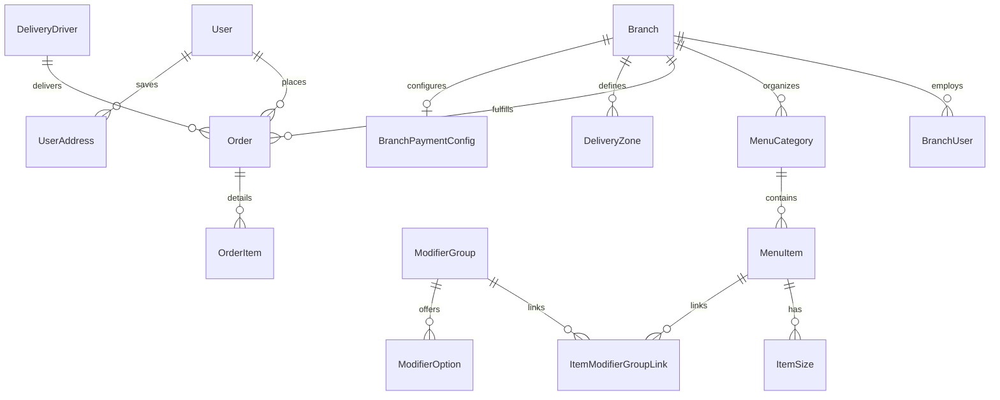

# UniFood System Architecture & Topology Specification

## 1. Executive Architecture Summary
UniFood is a hyper-localized food delivery and campus dining platform designed for high-density student housing, universities, and commercial cloud kitchens. The architecture is engineered around low-latency order placement, resilient real-time status dispatching, and automated order fulfillment via thermal POS printing and WhatsApp customer notifications.

```
                      +---------------------------------------+
                      |       Client Applications Layer       |
                      +-------------------+-------------------+
                                          |
        +---------------------------------+---------------------------------+
        |                                 |                                 |
+-------v-------+                 +-------v-------+                 +-------v-------+
|  Customer App |                 |  Desktop POS  |                 |  Driver Web   |
| (React 19/PWA)|                 |  (Electron 44)|                 | (Mobile View) |
+-------+-------+                 +-------+-------+                 +-------+-------+
        |                                 |                                 |
        | HTTPS / WSS                     | HTTPS / WSS                     | HTTPS / WSS
        +---------------------------------+---------------------------------+
                                          |
                      +-------------------v-------------------+
                      |      Express 5 / Node.js Engine       |
                      |   - Helmet & Rate Limit Protections   |
                      |   - Static SPA Dynamic Fallback       |
                      |   - Socket.io Real-time Bus           |
                      +-------------------+-------------------+
                                          |
        +---------------------------------+---------------------------------+
        |                                 |                                 |
+-------v-------+                 +-------v-------+                 +-------v-------+
|  PostgreSQL   |                 |    Baileys    |                 | Disk Uploads  |
| (Prisma 5.22) |                 | WhatsApp Bot  |                 | + DB Fallback |
+---------------+                 +---------------+                 +---------------+
```

---

## 2. Component Inventory & Technology Stack

| Layer | Technology | Version | Purpose |
| :--- | :--- | :--- | :--- |
| **Backend Runtime** | Node.js / Express | 5.3.0 | Central API gateway, business logic, unified SPA host |
| **Database ORM** | Prisma ORM (PostgreSQL) | 5.22.0 | Type-safe schema migrations, queries, and relations |
| **Realtime Engine** | Socket.io | 4.8.4 | Order lifecycle push events, kitchen chime triggers |
| **Customer App** | React / Vite / Tailwind | 19.2.8 / 8.3.4 | Customer mobile web, PWA, order tracking, address GPS |
| **Branch POS** | Electron / Vite / React | 44.7.0 / 19.2.8 | Cloud kitchen POS, 80mm ESC/POS thermal printing |
| **Notifications** | Baileys WhatsApp Web API | 7.0.0-rc14 | OTP verification, delivery receipts, daily shift reports |
| **Security Layer** | Helmet / express-rate-limit | 8.3.0 / 8.7.1 | HTTP header hardening, Brute-force & DDOS mitigation |

---

## 3. Data Topology & Entity Model

The system operates on an ACID-compliant relational schema in PostgreSQL managed by Prisma:



### Core Data Integrity Rules
1. **Branch Scoping:** All catalog items (`MenuItem`, `MenuCategory`, `ModifierGroup`) and operational metrics are strictly scoped to a `Branch`.
2. **Order Immutability:** Upon submission, an `Order` snapshots `unitPrice`, `sizeName`, and JSON `selectedModifiers` to prevent downstream price or recipe modifications from altering past financial records.
3. **Atomic Balance Deductions:** Student wallet transactions and promo usage are wrapped inside `prisma.$transaction` locks with explicit balance checks (`count === 0` throw) to prevent double-spending.

---

## 4. Multi-Tenant Role & Authorization Architecture

The platform partitions capabilities into four distinct authentication scopes:

1. **Super Admin (`SUPERADMIN`):**
   - Access to global platform controls, branch onboarding, financial aggregations, and WhatsApp bot configuration.
   - Guarded by `requireSuperAdmin` middleware.
2. **Branch Operator (`BRANCH`):**
   - Scoped strictly to POS order preparation, menu availability toggling, daily shift closures, and local delivery driver assignments.
   - Authenticated via `authenticateBranch` utilizing `branchUserId` and `branchId`.
3. **Delivery Driver (`DRIVER`):**
   - Mobile-optimized interface for accepting dispatched orders, GPS route visualization, and 4-digit pickup PIN confirmation.
   - Guarded by `authenticateDriver`.
4. **Customer (`CUSTOMER`):**
   - Phone-verified student accounts. Operations check `order.userId === req.user.userId` to enforce Object-Level Authorization (IDOR protection).

---

## 5. Unified Static Serving & Single Page App Fallback
The backend features a resilient static asset router in `backend/src/server.ts`:
- Detects the existence of built artifacts in `customer-app/dist`.
- Routes `/api/*` and `/socket.io/*` to API and WebSocket listeners.
- Provides static file serving for icons, manifest, service worker (`/sw.js`), and bundles.
- Serves `/uploads/:filename` from disk cache, dynamically falling back to PostgreSQL `bytea` storage if container restarts purge local ephemerals.
- Implements catch-all fallback (`*`) serving `index.html` for client-side routing.

---

## 6. Architectural Weaknesses & Modernization Debt
1. **Monolithic Admin Component:** `AdminPage.tsx` (~11,940 lines) combines state management, tab routing, modals, and business workflows into a single file, resulting in slow IDE analysis and high cognitive load.
2. **Floating Point Monetary Fields:** Monetary quantities (`subtotal`, `deliveryFee`, `walletBalance`) use IEEE 754 floating-point numbers (`Float`) instead of integer cents or `Decimal`, requiring defensive rounding across all checkout stages.
3. **Stateful Baileys Bot Process:** The WhatsApp integration runs in-process with the API server. In multi-instance horizontal scaling, sessions would require Redis coordination or an isolated microservice.
