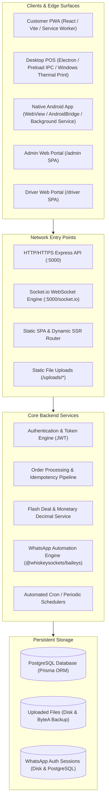

# UniFood Security Audit — Attack Surface Inventory

**Document Version:** 1.0.0  
**Scope:** Monorepo Architecture, Network Listeners, API Entry Points, Client Runtimes, and Schedulers

---

## 1. System Architecture & Component Inventory

---

## 2. Network Listeners & Protocols

| Port / Protocol | Service | Description | Access Scope |
| :--- | :--- | :--- | :--- |
| **TCP 5000 (HTTP/1.1)** | Express.js Application Server | REST API, Static Asset Serving, PWA manifests, SPA routing | Public / Internet Facing |
| **TCP 5000 (WebSocket)** | Socket.io Server | Real-time order dispatch, driver geolocation tracking, kitchen bells | Public / Authenticated Rooms |
| **TCP 5432 (PostgreSQL)** | PostgreSQL RDBMS | Managed database (Render / Neon / Local PostgreSQL) | Internal / Backend Only (`DATABASE_URL`) |
| **Outbound HTTPS (443)** | GitHub Raw & GitHub API | Dynamic server domain resolution (`server-config.json`, `app-config.json`) | Outbound from all client apps |
| **Outbound TCP (443/5222)** | WhatsApp Web Multi-Device | Baileys socket connection to WhatsApp servers | Outbound from backend server |

---

## 3. API Attack Surface & Route Classification

### 3.1. Public Endpoints (Unauthenticated)

| Route | Method | Rate Limiting | Risk Profile |
| :--- | :--- | :--- | :--- |
| `/api/health` | `GET` | `generalApiLimiter` | Database ping (`SELECT 1`), version disclosure |
| `/api/public/sound-settings` | `GET` | `generalApiLimiter` | Notification audio configurations |
| `/api/public/server-config` | `GET` | `generalApiLimiter` | Central domain resolution data |
| `/api/customer/public/restaurant-location` | `GET` | `generalApiLimiter` | Restaurant GPS coordinates |
| `/api/customer/public/support-contact` | `GET` | `generalApiLimiter` | Support WhatsApp contact info |
| `/api/customer/manifest` | `GET` | `generalApiLimiter` | Dynamic PWA manifest for restaurants |
| `/api/customer/apk-meta` | `GET` | `generalApiLimiter` | Mobile APK version and download metadata |
| `/api/customer/banners` | `GET` | `generalApiLimiter` | Active promo banners |
| `/api/customer/flash-deals` | `GET` | `generalApiLimiter` | Active limited-time deals |
| `/api/customer/branches` | `GET` | `generalApiLimiter` | Restaurant branches list and statuses |
| `/api/customer/branches/:id/menu` | `GET` | `generalApiLimiter` | Complete menu catalog and modifier groups |
| `/api/customer/promo-codes/validate` | `POST` | `generalApiLimiter` | Promo code evaluation (susceptible to brute force) |
| `/api/customer/group-cart/create` | `POST` | `generalApiLimiter` | Creates shared cart with 6-hex-char share code |
| `/api/customer/group-cart/:code` | `GET` | `generalApiLimiter` | Retrieves full cart contents and participant names |
| `/api/customer/group-cart/:code/items` | `POST` | `generalApiLimiter` | Appends items to shared cart |
| `/api/customer/group-cart/:code/items/:itemId` | `DELETE` | `generalApiLimiter` | **VULNERABLE (SEC-004):** Deletes items using spoofable `?studentName` |
| `/api/customer/group-cart/:code/close` | `POST` | `generalApiLimiter` | **VULNERABLE (SEC-004):** Unauthenticated cart shutdown |
| `/api/auth/register` | `POST` | `authLimiter` (20/15min) | Student registration & WhatsApp OTP trigger |
| `/api/auth/login` | `POST` | `authLimiter` (20/15min) | Unified credential login (Customer/Driver/Branch) |
| `/api/auth/forgot-password` | `POST` | `authLimiter` (20/15min) | Dispatches 6-digit WhatsApp recovery OTP |
| `/api/auth/verify-reset-otp` | `POST` | `authLimiter` (20/15min) | Validates recovery OTP |
| `/api/auth/reset-password` | `POST` | `authLimiter` (20/15min) | Changes password via verified OTP |
| `/api/auth/verify-phone-code` | `POST` | `generalApiLimiter` | 6-digit activation code verification |
| `/api/auth/verify-phone-link` | `POST`/`GET` | `generalApiLimiter` | Magic-link activation (**VULNERABLE: SEC-003**) |
| `/api/auth/resend-verification-otp` | `POST` | `authLimiter` (20/15min) | Re-sends activation code via WhatsApp |
| `/api/admin/login` | `POST` | `authLimiter` (20/15min) | Dedicated SuperAdmin credential authentication |
| `/api/branch/login` | `POST` | `authLimiter` (20/15min) | Dedicated Restaurant POS staff authentication |
| `/api/driver/login` | `POST` | `authLimiter` (20/15min) | Dedicated Delivery Driver authentication |
| `/uploads/:filename` | `GET` | None | **VULNERABLE (SEC-008):** Static serving of payment receipts & images |

---

### 3.2. Customer Role Endpoints (`role: CUSTOMER`)

Protected by `authenticateUser`:
- `GET /api/auth/me` — Current user profile
- `POST /api/customer/orders` — Order checkout pipeline (rate-limited via `orderLimiter`)
- `GET /api/customer/orders/:id` — Order status tracking (verified against `order.userId`)
- `GET /api/customer/my-orders` — User order history
- `PUT /api/customer/orders/:id/cancel` — Cancels PENDING order & refunds wallet atomically
- `POST /api/customer/orders/:id/rate` — Submits post-order rating and review
- `GET /api/customer/addresses` — Saved delivery addresses
- `POST /api/customer/addresses` — Creates delivery address
- `DELETE /api/customer/addresses/:id` — Deletes delivery address (scoped by `userId`)
- `PUT /api/customer/profile` — Updates customer display name
- `GET /api/customer/wallet` — Retrieves loyalty points and wallet balance
- `POST /api/customer/wallet/convert-points` — Converts loyalty points to wallet balance atomically
- `DELETE /api/customer/account` — Deletes or anonymizes account data
- `POST /api/customer/support-ticket` — Dispatches customer support ticket to administration
- `POST /api/upload` — Uploads payment receipts and avatar images (`authenticateAny`)

---

### 3.3. Restaurant Branch Role Endpoints (`role: BRANCH`)

Protected by `authenticateBranch`:
- `GET /api/branch/profile` — Restaurant operational settings & working hours
- `PUT /api/branch/operational-status` — Toggles OPEN / BUSY / CLOSED
- `PUT /api/branch/details` — Updates restaurant metadata, phone, and delivery settings
- `GET /api/branch/delivery-zones` — Delivery fee zones
- `POST /api/branch/delivery-zones` — Creates delivery zone
- `DELETE /api/branch/delivery-zones/:id` — Deletes delivery zone
- `PUT /api/branch/payment-methods` — Toggles Cash, Vodafone Cash, and InstaPay handles
- `GET /api/branch/menu` — Full branch menu manager view
- `POST /api/branch/categories` — Creates menu category
- `PUT /api/branch/categories/:id` — Updates menu category
- `DELETE /api/branch/categories/:id` — Deletes menu category
- `POST /api/branch/items` — Creates menu item
- `PUT /api/branch/items/:id` — Updates menu item
- `PUT /api/branch/items/:id/availability` — Quick stock toggle
- `DELETE /api/branch/items/:id` — Deletes menu item
- `POST /api/branch/modifier-groups` — Creates modifier group
- `PUT /api/branch/modifier-groups/:id` — Updates modifier group
- `DELETE /api/branch/modifier-groups/:id` — Deletes modifier group
- `POST /api/branch/modifier-groups/:groupId/options` — Creates option
- `PUT /api/branch/modifier-options/:id` — Updates option
- `DELETE /api/branch/modifier-options/:id` — Deletes option
- `POST /api/branch/items/:id/link-modifiers` — Links modifier groups to item
- `GET /api/branch/orders` — Kitchen order display view
- `PUT /api/branch/customers/:userId/crm` — **VULNERABLE (SEC-005):** Sets global `isBlocked`
- `PUT /api/branch/orders/:id/status` — Kitchen status transitions (ACCEPTED, PREPARING, READY, REJECTED)
- `GET /api/branch/drivers` — Drivers available to this branch
- `POST /api/branch/drivers` — Creates branch driver
- `PUT /api/branch/drivers/:id` — Updates branch driver
- `DELETE /api/branch/drivers/:id` — Deletes branch driver
- `PUT /api/branch/orders/:id/assign-driver` — Assigns driver to order
- `GET /api/branch/orders/:id/return-pin` — Retrieves order return authorization PIN
- `POST /api/branch/orders/:id/confirm-return-from-driver` — Confirms returned order
- `GET /api/branch/support-tickets` — Support tickets concerning this branch
- `PUT /api/branch/support-tickets/:id` — Updates branch support ticket notes
- `GET /api/branch/system-printers` — Windows PowerShell hardware printer query

---

### 3.4. Delivery Driver Role Endpoints (`role: DRIVER`)

Protected by `authenticateDriver`:
- `GET /api/driver/me` — Driver profile & serving branch configuration
- `GET /api/driver/orders` — Active orders assigned to driver (strips `pickupPin`)
- `PUT /api/driver/orders/:id/accept` — Driver accepts delivery assignment
- `PUT /api/driver/orders/:id/reject` — Driver rejects delivery assignment (triggers smart fallback dispatch)
- `POST /api/driver/orders/:id/return-to-branch` — Initiates return of undeliverable order
- `PUT /api/driver/orders/:id/pickup` — Confirms food pickup from restaurant kitchen
- `PUT /api/driver/orders/:id/deliver` — **Validates 4-digit customer PIN** and completes order

---

### 3.5. SuperAdmin Role Endpoints (`role: SUPERADMIN`)

Protected by `requireSuperAdmin`:
- `GET /api/admin/branches` — All branches with credentials and payment configs
- `POST /api/admin/branches` — Creates new restaurant branch
- `PUT /api/admin/branches/:id` — Updates branch metadata and delivery limits
- `DELETE /api/admin/branches/:id` — Deletes branch
- `POST /api/admin/branches/:id/credentials` — Resets POS login credentials
- `PUT /api/admin/branches/:id/payment-methods` — Overrides payment settings
- `GET /api/admin/stats` — Platform-wide revenue, order volumes, and metrics
- `GET /api/admin/orders` — Global orders monitoring
- `PUT /api/admin/orders/:id/status` — Administrative order override
- `GET /api/admin/users` — Registered customer list
- `PUT /api/admin/users/:id/toggle-verify` — Manual phone verification override
- `PUT /api/admin/users/:id/wallet` — Administrative wallet credit/debit
- `PUT /api/admin/users/:id/reset-password` — Administrative password reset
- `PUT /api/admin/change-password` — SuperAdmin password update
- `GET /api/admin/finance/report` — Financial reconciliation reports
- `GET /api/admin/finance/export-excel` — CSV / Excel financial dump
- `GET /api/admin/whatsapp/status` — Multi-device WhatsApp connectivity
- `GET /api/admin/whatsapp/accounts` — Registered WhatsApp bot numbers
- `POST /api/admin/whatsapp/accounts` — Registers new WhatsApp bot account
- `POST /api/admin/whatsapp/accounts/:id/refresh-qr` — Refreshes Baileys QR code
- `POST /api/admin/whatsapp/accounts/:id/disconnect` — Disconnects WhatsApp session
- `POST /api/admin/system/factory-reset` — High-risk database wipe and reset
- `POST /api/admin/seed-mock-data` / `POST /api/admin/seed-divado` — Database seed operations
- `POST /api/upload/audio` — Uploads notification audio files

---

## 4. WebSocket & Real-Time Event Attack Surface

Socket.io runs on `/socket.io/` with wildcard CORS:
- Connection authentication extracts Bearer token from handshake headers or auth payload (`io.use`). Unauthenticated connections are permitted but restricted to public events.
- **Rooms & Event Authorization:**
  - `admin_dashboard`: Restricted to `role: SUPERADMIN`.
  - `branch_<branchId>`: Restricted to authenticated branch token matching `branchId` or `SUPERADMIN`.
  - `order_<orderId>`: Validated against `order.userId`, `order.branchId`, `order.driverId`, or `SUPERADMIN`.
  - `driver_<driverId>`: Restricted to driver matching `driverId` or `SUPERADMIN`.
  - `user_<userId>`: Restricted to customer matching `userId` or `SUPERADMIN`.
  - `group_cart_<shareCode>`: Open to anyone possessing the `shareCode`.
  - `driver_location_update`: Emitted by driver, broadcasts live coordinates to customer and kitchen.

---

## 5. Background Tasks & Automated Schedulers

1. **Unaccepted Orders Watchdog (Every 45 seconds):**
   Scans for `PENDING` orders exceeding 5 minutes without kitchen acceptance. Dispatches automated escalation alerts to management via WhatsApp.
2. **Driver Unaccepted Alert Watchdog (Every 45 seconds):**
   Scans for `READY` orders where the assigned driver has not acknowledged delivery. Triggers driver re-dispatch or WhatsApp alert.
3. **Shift Closing Daily Financial Report (Every 60 seconds):**
   Evaluates each restaurant's `closingTime`. If a branch has closed within the last minute, calculates total orders, cash, and digital payments, generating and dispatching a financial summary via WhatsApp.
4. **Memory Watchdog (Every 60 seconds):**
   Monitors Node.js RSS and Heap usage. If RSS > 340MB or Heap > 280MB, logs high memory warnings and triggers `global.gc()` if V8 exposure flag is enabled.
5. **Periodic Image DB Backup (After 30-second boot):**
   Iterates disk uploads directory and syncs files <= 5MB to PostgreSQL `UploadedFile` table.

---

## 6. Client Application Attack Surfaces

### 6.1. Electron Desktop POS App (`desktop-app`)
- **Main Process:** `desktop-app/electron/main.cjs`
- **Security Flags:**
  - `nodeIntegration: false` (Secure)
  - `contextIsolation: true` (Secure)
  - `setWindowOpenHandler: () => ({ action: 'deny' })` (Secure)
- **Preload Bridge:** Exposes narrow `electronAPI` (`get-system-printers`, `print-receipt-silent`).
- **Surface Vulnerability (SEC-007):** Blindly attempts to load `http://localhost:5173` before loading local `dist/index.html`.

### 6.2. Native Android Application (`android-app`)
- **Main Activity:** `MainActivity.java` wrapping a full-screen `WebView`.
- **JavascriptInterface:** Exposes `AndroidBridge` with methods:
  - `getFlavor()`, `getServerUrl()`, `isNativeApp()`
  - `registerBackgroundSession(token, role, userId)` (writes to `SharedPreferences`)
  - `clearBackgroundSession()`
  - `showNotification(title, body)`
  - `downloadFile(filename, content, mimeType)` (writes to `MediaStore.Downloads`)
  - `openExternalUrl(url)` (validates scheme against `http`, `https`, `tel`, `mailto`, `whatsapp`, `geo`)
- **Surface Vulnerability (SEC-009):** `android:usesCleartextTraffic="true"` and hardcoded default release keystore passwords in `build.gradle`.
